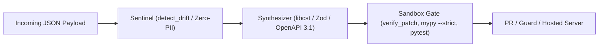

# SelfHealAPI: Self-Maintaining APIs & Autonomous Schema-Drift Engine

[](https://github.com/creova-gif/selfheal-api/actions/workflows/ci.yml)
[](LICENSE)
[](CHANGELOG.md)
[](pyproject.toml)

SelfHealAPI detects third-party API payload drift at the system boundary, redacts all scalar values into structural primitives before analysis, and synthesizes `libcst` adapter patches that pass strict sandbox verification (`verify_patch`, `mypy --strict`, and `pytest`) before a pull request is opened.



## Overview

Modern integrations break silently when upstream webhooks or REST APIs rename fields, coerce integers to strings, wrap scalars in lists, or nest properties. SelfHealAPI closes the loop between runtime detection and verified code remediation while enforcing a **Zero-PII boundary**:

1. **Sentinel (`src/sentinel/detector.py`)**: Validates incoming JSON payloads against Pydantic v2 models (`strict=True`), classifies every scalar into a zero-PII `PrimitiveKind` (`<str>`, `<int>`, `<int_str>`, `<float_str>`, `<bool_str>`, `<iso_datetime>`, `<null>`), and emits an immutable `DriftReport` with matched candidate source paths.
2. **Synthesizer (`src/synthesizer/patcher.py`)**: Transforms a `DriftReport` into a `PatchPlan` and applies a `libcst.CSTTransformer` to inject a typed `@model_validator(mode="before")` normalizer and safe union/literal widening without losing formatting.
3. **Sandbox Gate (`verify_patch`)**: Parses the patched CST, executes the model in an isolated namespace, validates both the drifted payload and canonical legacy payload with `strict=True`, and enforces `mypy --strict` + `pytest` before any patch is written or PR is opened.

- **Architecture, Security & Threat Model:** See [`AGENTS.md`](AGENTS.md), [`SECURITY.md`](SECURITY.md), [`docs/adr/001-redacted-ast-synthesis-and-sandbox-gate.md`](docs/adr/001-redacted-ast-synthesis-and-sandbox-gate.md), and [`docs/THREAT_MODEL.md`](docs/THREAT_MODEL.md).

## Features

- **Zero-PII Scalar Redaction:** Raw payload values never leave your boundary for LLM fallback (`AnthropicSchemaMappingProvider`) or persistent storage (`DriftEventLedger`).
- **Formatting-Preserving `libcst` Patching:** Generates typed Pydantic v2 `@model_validator(mode="before")` adapters, nested sub-model normalizers, and list/scalar coercions.
- **Fail-Closed Verification Gate:** Every patch must pass `verify_patch`, `mypy --strict --shadow-file`, and `pytest` before disk write or PR creation.
- **Multi-Target Emitters:** Emit TypeScript Zod preprocessors (`--zod`) and OpenAPI 3.1 `x-selfheal-aliases` / `x-selfheal-coercions` schemas (`--openapi`).
- **Runtime Guard & Middleware:** Drop-in `@selfheal_guard` decorator (sync/async) plus zero-dependency `SelfHealASGIMiddleware` and `SelfHealWSGIMiddleware`.
- **Hosted Multi-Tenant Server & Drift Console:** Cloud Run-ready HTTP server with HMAC webhook verification, SQLite WAL event ledger, Slack/webhook alerting, and an XSS-safe HTML5 Drift Console (`GET /dashboard`).
- **Replay Regression Harness:** Deterministic `run_replay_corpus` verification over recorded redacted samples.

## Installation

Requires **Python 3.12+**:

```bash
git clone https://github.com/creova-gif/selfheal-api.git
cd selfheal-api

python3.12 -m venv .venv
source .venv/bin/activate
pip install -e ".[dev]"
```

Run the quality gates locally:

```bash
.venv/bin/ruff check src tests
.venv/bin/mypy --strict src tests
.venv/bin/pytest -v
```

## Usage

### `selfheal` CLI (`init`, `check`, `heal`, `schema`, `replay`, `doctor`)

```bash
# Scaffold starter selfheal.config.json and GitHub Actions workflow
selfheal init

# Verify Python, SQLite, dependencies, and toolchain readiness (zero-secret output)
selfheal doctor --json

# Detect schema drift and emit zero-PII DriftReport JSON (exit 0=clean, 1=drift, 2=error)
selfheal check --model path/to/models.py:Invoice --payload drifted.json

# Emit standalone JSON Schema, OpenAPI 3.1.0, or TypeScript/Zod from any Pydantic model
selfheal schema --model path/to/models.py:Invoice --format openapi --out openapi.json

# Replay a JSONL corpus against a Pydantic model
selfheal replay --model path/to/models.py:Invoice --corpus samples.jsonl

# Synthesize a libcst patch, run verify_patch + mypy --strict --shadow-file + pytest,
# preview the unified diff, emit TypeScript Zod & OpenAPI 3.1 outputs, write, and open a PR
selfheal heal \
  --model path/to/models.py:Invoice \
  --payload drifted.json \
  --canonical canonical.json \
  --diff \
  --zod generated/invoice_adapter.ts \
  --openapi generated/openapi.json \
  --write \
  --open-pr
```

Useful `heal` flags:
- `--llm-fallback`: enable zero-PII `AnthropicSchemaMappingProvider` for opaque field renames.
- `--pytest-args "..."`: pass extra arguments to the `pytest` verification gate.
- `--branch <name>`: override the auto-generated `selfheal/<model>-<fingerprint>` branch name.

### Runtime Guard (`@selfheal_guard`)

Decorate sync or async boundary handlers to detect drift in-process, deduplicate identical drift fingerprints, and optionally normalize incoming payloads (`normalize=True`):

```python
from sentinel.guard import DriftDeduplicator, selfheal_guard
from sentinel.llm_fallback import AnthropicSchemaMappingProvider

dedup = DriftDeduplicator(max_fingerprints=1024)
provider = AnthropicSchemaMappingProvider(max_calls=50)

@selfheal_guard(
    Invoice,
    mapping_provider=provider,
    deduplicator=dedup,
    normalize=True,
    on_drift=lambda report, fp: print(f"Drift detected ({fp[:8]}): {len(report.issues)} issues"),
)
async def handle_webhook(payload: dict[str, object]) -> Invoice:
    return Invoice.model_validate(payload)
```

### ASGI & WSGI Middleware

Inspect JSON request bodies at runtime without framework lock-in using `SelfHealASGIMiddleware` or `SelfHealWSGIMiddleware` with `RouteBinding`:

```python
from selfheal_api import RouteBinding, SelfHealASGIMiddleware

app = SelfHealASGIMiddleware(
    fastapi_or_starlette_app,
    routes=[RouteBinding(path="/webhooks/invoice", model_cls=Invoice, normalize=True)],
    on_drift=lambda report, fp: print(f"Route drift {fp[:8]}: {len(report.issues)} issues"),
)
```

### Replay Regression Harness

Validate a `PatchPlan` against a corpus of recorded samples using `run_replay_corpus`:

```python
from selfheal_api.replay import ReplaySample, run_replay_corpus

samples = [ReplaySample(sample_id="stripe-v2", payload=drifted_payload)]
report = run_replay_corpus(Invoice, samples, plan=patch_result.plan)
assert report.failed == 0
```

### TypeScript / Zod Adapter Emission

Generate a typed TypeScript preprocessor alongside Python CST patches via `selfheal heal --zod <out.ts>` or programmatically with `synthesize_zod_preprocessor(plan)`:

```ts
import { z } from 'zod';
import { createSelfHealZodAdapter } from './invoice_adapter';

const InvoiceSchema = createSelfHealZodAdapter(
  z.object({ id: z.string(), amount_cents: z.number().int() }),
);
```

### Hosted Multi-Tenant Server & Drift Console

Run the hosted webhook receiver locally or deploy to GCP Cloud Run using `Dockerfile` and [`deploy/cloudrun.yaml`](deploy/cloudrun.yaml):

```bash
python -m selfheal_api.server
# or via the installed console script:
selfheal-server
```

Endpoints:
- `GET /healthz` (`HEAD` supported): liveness probe.
- `GET /readyz` (`HEAD` supported): readiness probe verifying `DriftLedger`, `BillingStore`, and `InstallationRegistry` SQLite health.
- `GET /metrics` (`?format=prometheus`): JSON or Prometheus v0.0.4 telemetry metrics.
- `GET /openapi.json`: live OpenAPI 3.1.0 specification including registered `model_registry` schemas.
- `POST /webhooks/drift`: multi-tenant drift ingestion with HMAC verification, rate limiting, and Slack/webhook alerting.
- `POST /webhooks/stripe` & `POST /webhooks/github`: Stripe billing and GitHub App installation webhook handlers.
- `GET /dashboard`: WCAG 2.1 AA self-contained, CSP-strict HTML5 Drift Console with audit export links.
- `GET /api/v1/events` (`?limit=...&offset=...&model=...`), `GET /api/v1/events/export` (`?format=csv|jsonl`), and `GET /api/v1/summary`: SQLite WAL zero-PII drift event ledger and audit export APIs.

## Configuration

See [`.env.example`](.env.example) for a starter template. The hosted server (`src/selfheal_api/server.py`), Cloud Run manifest (`deploy/cloudrun.yaml`), and LLM fallback provider (`src/sentinel/llm_fallback.py`) read the following environment variables:

| Variable | Default | Description |
| --- | --- | --- |
| `PORT` | `8080` | HTTP listen port for `selfheal-server` / Cloud Run. |
| `SELFHEAL_HOST` | `0.0.0.0` | Bind host address for `selfheal-server`. |
| `SELFHEAL_DB_PATH` | `:memory:` | SQLite WAL persistence path (e.g. `/data/selfheal.db`) for ledger, billing, and installations. |
| `SELFHEAL_RETENTION_DAYS` | `0` | Startup retention window in days (`> 0` prunes expired drift events on boot). |
| `SELFHEAL_MODELS` | `""` | Comma-separated `module.path:ClassName` specs loaded at startup. |
| `SELFHEAL_WEBHOOK_SECRET` | `""` | HMAC-SHA256 shared secret for `POST /webhooks/drift`. |
| `STRIPE_WEBHOOK_SECRET` | `""` | Stripe webhook signing secret (falls back to `SELFHEAL_STRIPE_WEBHOOK_SECRET`). |
| `GITHUB_APP_WEBHOOK_SECRET` | `""` | GitHub App webhook signing secret (falls back to `SELFHEAL_GITHUB_WEBHOOK_SECRET`). |
| `SELFHEAL_MAX_RPM` | `60` | Per-tenant requests-per-minute rate limit. |
| `SELFHEAL_MAX_LLM_CALLS` | `20` | Per-tenant cap on zero-PII LLM fallback calls. |
| `SELFHEAL_SLACK_WEBHOOK_URL` | `""` | Optional `https://` Slack webhook URL for zero-PII drift alerts. |
| `SELFHEAL_ALERT_WEBHOOK_URL` | `""` | Optional `https://` generic webhook URL for signed `DriftAlert` notifications. |
| `SELFHEAL_ALERT_WEBHOOK_SECRET` | `""` | Optional HMAC-SHA256 secret (`X-SelfHeal-Signature`) for `SELFHEAL_ALERT_WEBHOOK_URL`. |
| `ANTHROPIC_API_KEY` | `""` | API key for `AnthropicSchemaMappingProvider` when `--llm-fallback` is enabled. |

## Benchmarks

Measured on Python 3.12.12 (`pydantic 2.14.4`, `libcst 1.9.0`) across the 40-mutation benchmark suite simulating Stripe, HubSpot, and Weather API drift (`tests/test_drift_and_patch.py`):

| Metric | Target threshold | Measured result | Evidence |
| --- | --- | --- | --- |
| Drift detection recall | 100% | **100.0%** (40 / 40) | `test_40_mutation_benchmark_thresholds` |
| Auto-patch verification pass rate | >= 85% | **100.0%** (40 / 40) | `test_40_mutation_benchmark_thresholds` |
| Sentinel runtime check latency (median) | < 2.0 ms | **0.017 ms** (range 0.016 to 0.020 ms across 7 runs) | Bound by `pydantic-core` validation + dict traversal on 1 core |
| Sentinel runtime check latency (p99) | < 2.0 ms | **0.040 ms** (range 0.033 to 0.059 ms across 7 runs) | Bound by `ValidationError` formatting and token scoring |

Regenerate the benchmark numbers with:

```bash
PYTHONPATH=src .venv/bin/python -c "
import statistics
from tests.test_drift_and_patch import ALL_40_MUTATIONS
from sentinel import detect_drift
from synthesizer import synthesize_patch, verify_patch

for _, m, _, _, mut in ALL_40_MUTATIONS:
    detect_drift(m, mut)

medians, p99s = [], []
for _ in range(7):
    s = sorted(detect_drift(m, mut).elapsed_ms for _, m, _, _, mut in ALL_40_MUTATIONS)
    medians.append(s[len(s) // 2])
    p99s.append(s[int(len(s) * 0.99)])

detected = sum(1 for _, m, _, _, mut in ALL_40_MUTATIONS if detect_drift(m, mut).has_drift)
passed = sum(1 for _, m, src, can, mut in ALL_40_MUTATIONS if verify_patch(synthesize_patch(src, detect_drift(m, mut)), mut, can).passed)
print(f'Recall: {detected}/{len(ALL_40_MUTATIONS)} | Pass: {passed}/{len(ALL_40_MUTATIONS)} | Median: {statistics.median(medians):.3f}ms | p99: {statistics.median(p99s):.3f}ms')
"
```

## Contributing

Contributions are welcome! Please read [`CONTRIBUTING.md`](CONTRIBUTING.md) for local setup, quality gates (`ruff`, `mypy --strict`, `pytest`), ADR guidelines, and Zero-PII security requirements.

## License

Licensed under the [MIT License](LICENSE).
